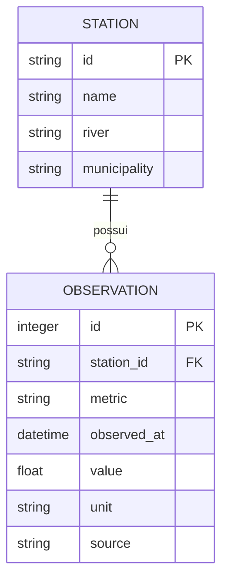

# Sistema de Monitoramento Hidrológico

API REST em Python e Django para consultar estações fictícias e acompanhar leituras de nível da água e chuva. Desenvolvida para a trilha backend do Desafio de Monitoramento Hidrológico da Cogmo Technology, com SQLite para armazenamento local.

> Os dados são sintéticos e servem para demonstração. Use-os apenas no contexto do exercício.

## Sumário

- [Tecnologias](#tecnologias)
- [Estrutura do projeto](#estrutura-do-projeto)
- [Como executar](#como-executar)
- [Dados de demonstração](#dados-de-demonstração)
- [Documentação da API](#documentação-da-api)
- [Autenticação e permissões](#autenticação-e-permissões)
- [Modelo de dados](#modelo-de-dados)
- [Validação local](#validação-local)
- [Correspondência com o desafio](#correspondência-com-o-desafio)
- [Equipe](#equipe)

## Tecnologias

| Tecnologia | Uso |
| --- | --- |
| Python 3.12 | Ambiente de desenvolvimento documentado |
| Django | Configuração da aplicação, ORM, migrações e painel administrativo |
| Django REST Framework | API REST, autenticação e paginação |
| django-filter | Filtros de estações e observações |
| drf-spectacular e Sidecar | OpenAPI, Swagger UI e ReDoc |
| SQLite | Banco local da aplicação |
| pandas | Geração opcional do CSV pelo script de demonstração |

As dependências da aplicação estão listadas em [utilities/requirements.txt](utilities/requirements.txt).

## Estrutura do projeto

```text
sistema-de-monitoramento-hidrologico/
├── manage.py
├── dados_estacoes_excel.csv
├── core/
│   ├── settings.py
│   └── urls.py
├── monitoring/
│   ├── admin.py
│   ├── models.py
│   ├── serializers.py
│   ├── urls.py
│   ├── views.py
│   ├── tests.py
│   ├── migrations/
│   └── management/commands/importar_csv.py
└── utilities/
    ├── requirements.txt
    └── seed.js/seed.py
```

O arquivo `db.sqlite3` é o banco local utilizado pelo Django. As migrações criam as tabelas e o comando de importação popula os dados de demonstração.

## Como executar

### 1. Clonar o repositório

Tenha o Git e o Python instalados. Execute os comandos na pasta que contém o `manage.py` a partir do passo 2.

```bash
git clone https://github.com/johny-santos/sistema-de-monitoramento-hidrologico.git
cd sistema-de-monitoramento-hidrologico
```

### 2. Criar e ativar o ambiente virtual

**Windows PowerShell**

```powershell
python -m venv venv_windows
.\venv_windows\Scripts\Activate.ps1
```

**Linux ou macOS**

```bash
python3 -m venv .venv
source .venv/bin/activate
```

### 3. Instalar, preparar o banco e iniciar o servidor

```bash
python -m pip install -r utilities/requirements.txt
python manage.py check
python manage.py migrate
python manage.py importar_csv
python manage.py runserver
```

Abra a [API](http://127.0.0.1:8000/api/) e confira os registros na [lista de estações](http://127.0.0.1:8000/api/stations/).

## Dados de demonstração

O comando `python manage.py importar_csv` lê `dados_estacoes_excel.csv` na raiz do projeto. O arquivo usa ponto e vírgula como separador e UTF-8 com BOM. A importação atualiza ou cria estações pelo identificador e observações pela combinação de estação, métrica e horário. Importar novamente o mesmo CSV atualiza os registros correspondentes.

Para gerar outro CSV, execute da raiz do projeto. O gerador sobrescreve `dados_estacoes_excel.csv` e usa `pandas`, uma dependência adicional para esta etapa.

```bash
python -m pip install pandas
python utilities/seed.js/seed.py
python manage.py importar_csv
```

## Documentação da API

| Interface | Endereço local |
| --- | --- |
| Raiz da API | [`/api/`](http://127.0.0.1:8000/api/) |
| Swagger UI | [`/api/docs/`](http://127.0.0.1:8000/api/docs/) |
| ReDoc | [`/api/redoc/`](http://127.0.0.1:8000/api/redoc/) |
| Schema OpenAPI | [`/api/schema/`](http://127.0.0.1:8000/api/schema/) |
| Django Admin | [`/admin/`](http://127.0.0.1:8000/admin/) |

### Endpoints

| Método | Rota | Uso |
| --- | --- | --- |
| GET | `/api/stations/` | Listar estações |
| GET | `/api/stations/{id}/` | Consultar uma estação pelo identificador textual, como `EST-01` |
| GET | `/api/stations/{id}/summary/` | Consultar a localização, o total de observações e a última leitura de cada métrica |
| GET | `/api/stations/{id}/series/` | Consultar a série histórica de uma métrica |
| GET | `/api/observations/` | Listar observações |
| GET | `/api/observations/{id}/` | Consultar uma observação pelo ID numérico |
| POST | `/api/stations/` ou `/api/observations/` | Criar um registro com autenticação |
| PUT, PATCH, DELETE | Rota de detalhe do recurso | Atualizar ou excluir um registro com autenticação |
| POST | `/api/token/` | Obter um token com usuário e senha do Django |

As duas listagens são paginadas em até 100 registros por página. Estações aceitam filtros por `river` e `municipality`, além de `search` por nome, rio ou município. Observações aceitam `station`, `metric`, `source`, `observed_after` e `observed_before`. Use `ordering=observed_at` para ordenar por horário ou `ordering=-value` para ordenar por valor decrescente.

### Resumo e série histórica

Em `summary/`, o campo `latest` contém as chaves `level` e `rain`. Quando a estação ainda não possui leitura de uma métrica, o valor correspondente é `null`.

| Parâmetro de `series/` | Obrigatório | Valores |
| --- | --- | --- |
| `metric` | Sim | `level` para nível em metros ou `rain` para chuva em milímetros por hora |
| `hours` | Não | Inteiro de 1 a 720 na implementação atual, com padrão 24 |

A janela começa `hours` horas antes da última leitura disponível para a estação e a métrica consultadas. Os pontos são ordenados do mais antigo para o mais recente, com datas em ISO 8601 e UTC. Horários sem observação ficam fora da série. Uma série sem leituras retorna `count: 0`, `points: []` e `unit: null`.

Exemplo de consulta para [nível da estação EST-01 nas últimas 24 horas da série](http://127.0.0.1:8000/api/stations/EST-01/series/?metric=level&hours=24). O JSON abaixo ilustra o formato com um único ponto.

```json
{
  "station": "EST-01",
  "metric": "level",
  "hours": 24,
  "unit": "m",
  "count": 1,
  "points": [
    {
      "observed_at": "2026-11-01T19:00:00Z",
      "value": 1.05,
      "unit": "m"
    }
  ]
}
```

A série retorna `400 Bad Request` para métrica ausente ou inválida e para janelas fora do intervalo aceito. Recursos inexistentes retornam `404 Not Found`. As observações importadas têm `source: "synthetic"`. O formato atual de `series/` contém apenas os metadados da consulta e os pontos.

## Autenticação e permissões

As consultas são públicas. Na configuração atual, qualquer usuário autenticado pode criar, atualizar ou excluir pela API. O painel Django Admin exige uma conta com acesso administrativo. Para criar uma conta local para a demonstração, execute:

```bash
python manage.py createsuperuser
```

Para obter um token no PowerShell, com o servidor em execução, use a conta que você criou. O exemplo usa a estação `EST-01` importada pelo CSV.

```powershell
$baseUrl = "http://127.0.0.1:8000"
$credencial = Get-Credential
$corpo = @{
    username = $credencial.UserName
    password = $credencial.GetNetworkCredential().Password
} | ConvertTo-Json

$token = (Invoke-RestMethod -Uri "$baseUrl/api/token/" -Method Post `
    -ContentType "application/json" -Body $corpo).token

$headers = @{ Authorization = "Token $token" }
Invoke-RestMethod -Uri "$baseUrl/api/stations/EST-01/" -Headers $headers
```

No Swagger, use o esquema `tokenAuth` em **Authorize** e informe o cabeçalho no formato `Token <seu_token>`. A API também aceita autenticação pela sessão do Django.

## Modelo de dados

### MER

Uma estação identifica o local monitorado e pode possuir zero ou muitas observações. Cada observação pertence a exatamente uma estação e registra uma métrica em um horário.

### DER



A combinação `station_id`, `metric` e `observed_at` é única. A exclusão de uma estação remove suas observações em cascata. A definição está em [monitoring/models.py](monitoring/models.py).

## Validação local

Depois de executar as migrações e importar o CSV, confira:

1. `GET /api/stations/` retorna estações e `GET /api/observations/` retorna leituras.
2. `GET /api/stations/EST-01/summary/` retorna a estação e as últimas leituras.
3. `GET /api/stations/EST-01/series/?metric=rain&hours=24` retorna pontos ordenados em `mm/h`.
4. Repetir a consulta com `metric=temperatura` retorna HTTP 400.
5. Uma tentativa de escrita sem autenticação retorna HTTP 401 na configuração atual.

O comando `python manage.py test` executa a descoberta de testes do Django. O arquivo [monitoring/tests.py](monitoring/tests.py) ainda é o arquivo inicial e está sem casos automatizados.

## Correspondência com o desafio

O guia da Cogmo define uma janela de 1 a 72 horas e pede que cada resposta identifique os dados como simulados. Na branch `main`, a série aceita até 720 horas e algumas respostas, como a listagem de estações e a própria série, ainda não incluem um indicador de simulação. O enunciado da adaptação também pede a geração de `observations.csv` em Python puro. O gerador atual usa `pandas` e grava `dados_estacoes_excel.csv`. Estes pontos precisam de ajuste no código para atender ao enunciado integralmente.

## Equipe

- Johny Oliveira Santos
- Ana Luisa Santos de Oliveira
- Victor Hugo da Silva Sousa

Desafio proposto pela **Cogmo Technology**.
